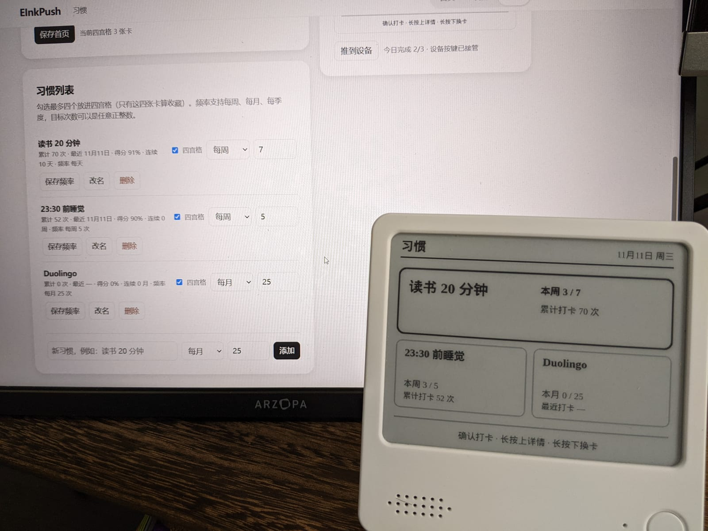
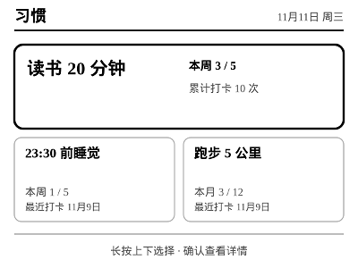
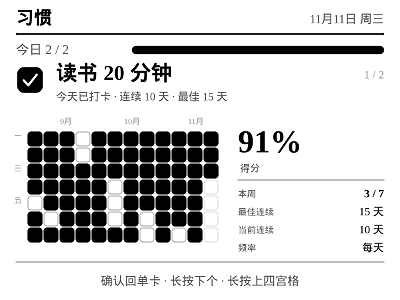
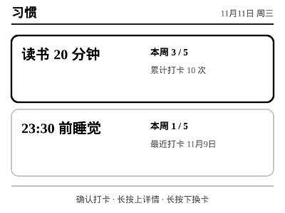
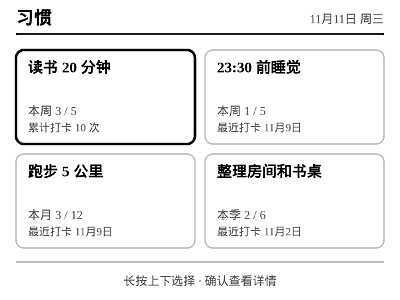
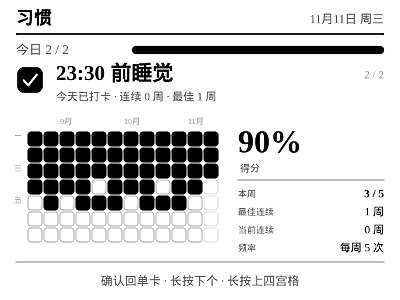

# Zectrix Habit

[简体中文](README.md) · English

An e-ink habit tracker for the **Zectrix NOTE4**, built as an app on the
[EInk-Push](https://github.com/moyubyte/EInk-Push) hub.



## Status: a hub app, shipped as a standalone challenge build

This repository is the **challenge submission** for Habit. It is a fork of
**EInk-Push 0.4.4** and contains the complete hub, so there is no separate
EInk-Push install step.

Habit is still a normal hub app: `src/apps.js` discovers it under `apps/habit/`,
and it uses the hub’s device protocol, image pipeline, authentication, and event
bus. The device never talks to Habit directly.

Two launch modes:

- `npm start` — **habit-only**: loads only `apps/habit`; `/` redirects to
  `/apps/habit/`.
- `npm run start:full` — **full hub**: loads every upstream app alongside Habit.

The only hub-side additions for this challenge are a small app filter
(`--apps habit` / `APPS_INCLUDE=habit`) and the default-app redirect. The device
protocol and rendering pipeline remain upstream EInk-Push.

## What Habit does

- **Single or quadrant home.** Show one habit, or pin 1–4 habits. The quadrant
  home adapts to the count: 1 = full card, 2 = two stacked wide cards, 3 = wide
  top + two small cards, 4 = 2×2 grid.
- **Check-in from either home.** OK checks in / unchecks the current card. Long
  up opens detail; long down moves to the next card.
- **Period-aware cards.** The left side shows current-period completeness
  (`本周 3 / 7`, `本月 0 / 25`, `本季 2 / 6`). The right side shows the last
  check-in date, or total check-ins once today is done.
- **Detail view.** 12-week heatmap, current/best streak, Loop-style score
  (90-day window, 13-day half-life, divided by frequency-expected completions),
  and the frequency panel.
- **Flexible frequency.** Weekly, monthly, or quarterly, with any positive target
  count.
- **Web editor.** Add/rename/delete habits, edit frequency, choose the four
  quadrant pins, preview the exact 400×300 card, and push manually.
- **On-device mode switch.** From detail: OK switches to single mode at that
  habit; long up switches to quadrant mode; long down flips to the next habit’s
  detail. Mode changes are persisted.

## Screens

| Single home | Quadrant home (3 pinned) | Detail (daily history) |
| --- | --- | --- |
|  |  |  |

More layouts:

| 2 pinned | 4 pinned | Detail (weekly history) |
| --- | --- | --- |
|  |  |  |

## How it works

- **Hub layer (upstream EInk-Push).**
  - `src/client.js` + `src/packet.js`: LAN v1 protocol, handshake, image/audio
    transport, retries, device events.
  - `src/image.js`: PNG → device palette, dithering, bit packing.
  - `src/server.js`: Express server, auth, event consumption, app mounting.
  - `src/apps.js`: directory discovery and the app contract.
  - `apps/shared/canvas.js`: 400×300 canvas, CJK font resolution, text wrapping,
    downsampling/sharpen/Png export.
- **Habit app (`apps/habit/`).**
  - `state.js`: pure logic—date keys, period bounds/counts, streaks, score, home
    layout, card stats, old-data normalization. No fs/canvas/network.
  - `render.js`: pure `data → PNG` for single home, adaptive quadrant home, and
    detail.
  - `index.js`: app definition, Express routes, device key handling, 65 s key
    lease, `onScreenTaken` guard, view/mode state.
  - `store.js`: atomic `tmp + rename` JSON persistence.
  - `page.html`: web UI for habits, frequency, quadrant pins, preview, push.
- **Data.** `data/habit/state.json` (gitignored) with habits, per-day entries,
  single/quadrant selection, and mode.
- **Keys.** Confirm short = check-in; long up = detail; long down = next card.
  Up/down short is the global app switch. Confirm-long is invalid in LAN v1, so
  it is never used.
- **Tests.** Pure logic + rendering + MockDevice end-to-end, plus a habit-only
  launch test. `npm test` needs no hardware.

## Run it

Requirements: Node.js 22+ and npm.

```bash
npm install

# Challenge default: habit-only
npm start
# http://localhost:8080/ redirects to /apps/habit/

# Full hub: all upstream apps plus Habit
npm run start:full

# Tests (mock device; no hardware required)
npm test
```

The web UI and previews work without hardware. For real pushes, open
`http://<host>:8080/device` and save the Zectrix address, or start with
`--device <ip[:port]>`. Initial web password is `helloworld`.

## Full-run option

If you want the complete EInk-Push daily-driver set, run `npm run start:full`.
The upstream apps (today, vocabulary, what-to-eat, life guide, pet, jiaobei) are
still there, and Habit remains available at `/apps/habit/`. Short up/down on the
device cycles apps as before.

## What changed vs upstream

- `apps/habit/` — the Habit app, its renderer, tests, screenshots, and README.
- `src/apps.js` / `src/server.js` — optional app include filter and default-app
  redirect for habit-only mode.
- `src/index.js` — `--apps` / `APPS_INCLUDE` parsing.
- `package.json` — `npm start` = habit-only; `npm run start:full` = full hub.
- `test/apps-habit-only.test.js` — challenge-mode launch test.
- `NOTICE`, root README, and hub README additions.

Everything else is upstream EInk-Push 0.4.4.

## Attribution

Based on **EInk-Push 0.4.4** by
[moyubyte](https://github.com/moyubyte/EInk-Push), licensed under Apache-2.0.
Upstream code was imported at EInk-Push 0.4.4 / upstream commit `05211223`.

The Habit app, challenge launcher/filter, screenshots, and documentation are
additions for this submission. All upstream files retain their original copyright
and license notices.

- Full upstream/hub documentation: [`README.upstream.md`](./README.upstream.md)
- Habit implementation details and gestures:
  [`apps/habit/README.md`](./apps/habit/README.md)
- License: [`LICENSE`](./LICENSE)
- Attribution notice: [`NOTICE`](./NOTICE)
