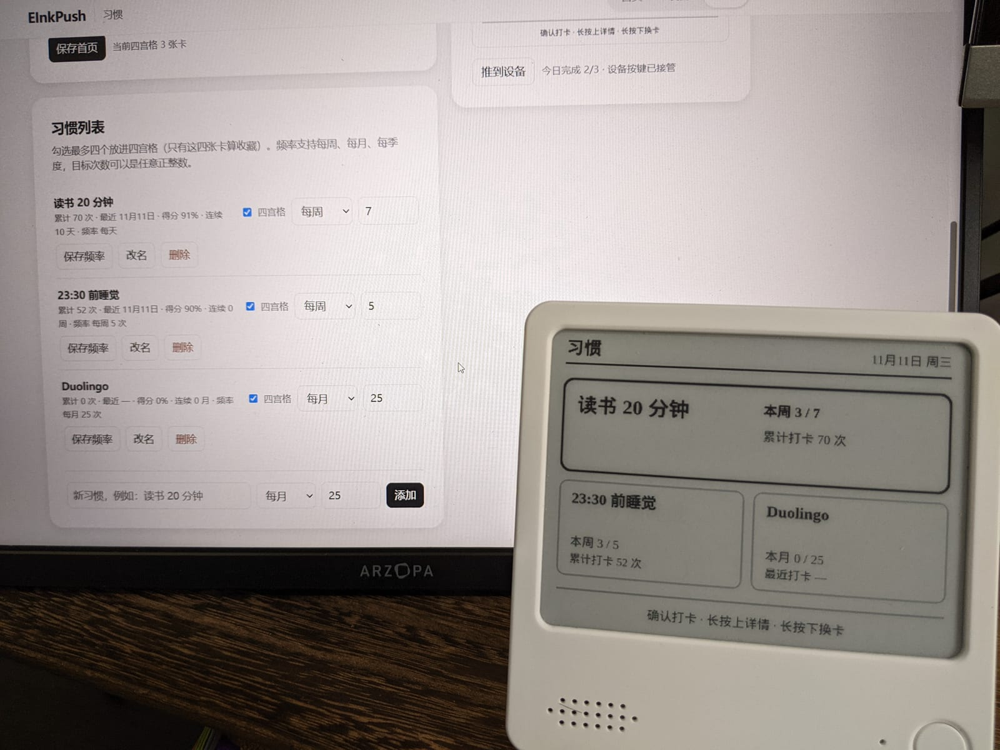
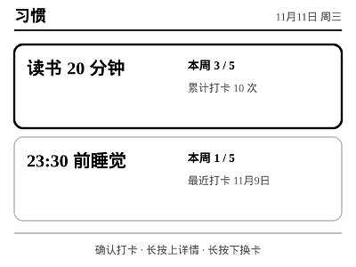

# Zectrix Habit

[English](README.en.md) · 简体中文

面向 **Zectrix NOTE4** 墨水屏的习惯打卡应用，作为
[EInk-Push](https://github.com/moyubyte/EInk-Push) 的一个应用运行。



## 项目定位：hub 里的应用，开箱即用的仓库

Habit 不是独立服务器，而是 EInk-Push hub 里的一个应用：`src/apps.js` 会自动发现
`apps/habit/`，由 hub 统一负责设备协议、图像编码、认证和事件总线；设备不直接连接
Habit。

本仓库是 **EInk-Push 0.4.4 的 fork**，包含了完整 hub，因此不需要另外安装
EInk-Push。启动方式有两种：

- `npm start` — **只启动习惯应用**：仅加载 `apps/habit`，`/` 会跳转到
  `/apps/habit/`。
- `npm run start:full` — **完整 hub**：加载上游全部应用，Habit 仍在
  `/apps/habit/`。

两种方式的区别是本仓库最需要注意的地方。hub 侧新增的只有应用过滤
（`--apps habit` / `APPS_INCLUDE=habit`）和默认应用跳转；设备协议、图像管线仍是上游
EInk-Push。

## Habit 做什么

- **单卡 / 四宫格首页。** 可以只显示一个习惯，也可以收藏 1～4 个习惯。四宫格会按
  数量自动排版：1 个占满整屏，2 个上下两张宽卡，3 个上宽下两张小卡，4 个标准
  2×2。
- **首页直接打卡。** 两种首页模式都用确认键打卡/取消；长按上进入详情，长按下换下一张
  卡。
- **周期完成度。** 卡片左侧显示当前周期完成度（`本周 3 / 7`、`本月 0 / 25`、
  `本季 2 / 6`）；右侧平时显示最近打卡日期，今天已打卡后改为累计次数。
- **详情页。** 12 周热力图、当前/最佳连续、Loop 式得分（90 天窗口、13 天半衰期、
  除以频率期望完成数）和频率面板。
- **灵活频率。** 支持每周、每月、每季度，以及任意正整数目标次数。
- **网页编辑。** 增删改习惯、编辑频率、选择四宫格收藏、预览 400×300 卡片、手动推送。
- **设备上切换模式。** 详情页按确认切回当前习惯的单卡；长按上切到四宫格；长按下翻到
  下一个习惯的详情；模式会保存，网页端同步显示。

## 界面

| 单卡首页 | 四宫格首页（3 张） | 详情页（每日历史） |
| --- | --- | --- |
|  |  |  |

更多排版：

| 2 张收藏 | 4 张收藏 | 详情页（每周历史） |
| --- | --- | --- |
|  |  |  |

## 工作方式

- **Hub 层（上游 EInk-Push）。**
  - `src/client.js` + `src/packet.js`：LAN v1 协议、握手、图片/音频传输、重试、
    设备事件。
  - `src/image.js`：PNG 到设备色板、抖色、按位打包。
  - `src/server.js`：Express 服务、认证、事件消费、应用挂载。
  - `src/apps.js`：目录发现与应用契约。
  - `apps/shared/canvas.js`：400×300 画布、中文字体解析、折行、降采样、锐化与
    PNG 导出。
- **Habit 应用层（`apps/habit/`）。**
  - `state.js`：纯逻辑——日期键、周期边界/计数、连续、得分、首页布局、卡片统计、
    旧数据归一化；不碰 fs/canvas/网络。
  - `render.js`：纯 `数据 → PNG`，负责单卡首页、自适应四宫格首页和详情页。
  - `index.js`：应用定义、Express 路由、设备按键处理、65 秒按键租约、
    `onScreenTaken` 保护、视图/模式状态。
  - `store.js`：`临时文件 + rename` 的原子 JSON 落盘。
  - `page.html`：网页端习惯管理、频率、四宫格选择、预览与推送。
- **数据。** `data/habit/state.json`（已 gitignore），保存习惯、每日打卡、单卡/四宫格
  选择和模式。
- **按键。** 确认短按 = 打卡；长按上 = 详情；长按下 = 下一张。上/下短按仍是全局切换
  应用；LAN v1 里确认长按是非法组合，所以不使用。
- **测试。** 纯逻辑 + 渲染 + MockDevice 端到端，以及只加载 habit 的启动测试；
  `npm test` 不需要真机。

## 运行

环境：Node.js 22+ 和 npm。

```bash
npm install

# 默认：只启动习惯应用
npm start
# http://localhost:8080/ 会跳转到 /apps/habit/

# 完整 hub：上游全部应用 + Habit
npm run start:full

# 测试（MockDevice，不需要真机）
npm test
```

网页和预览不需要设备。真机推送时打开 `http://<host>:8080/device` 保存 Zectrix 地址，
或用 `--device <ip[:port]>` 启动。初始网页密码是 `helloworld`。

## 设备手势

| 视图 | 确认短按 | 长按上 | 长按下 |
| --- | --- | --- | --- |
| 单卡首页 | 打卡 / 取消 | 打开详情 | 下一个习惯 |
| 四宫格首页 | 当前卡打卡 / 取消 | 打开详情 | 下一张收藏卡 |
| 详情页 | 切回当前习惯的单卡 | 切到四宫格首页 | 下一个习惯详情 |

## 与上游 EInk-Push 的差异

- `apps/habit/` — Habit 应用、渲染、测试、截图和说明。
- `src/apps.js` / `src/server.js` — 可选的应用过滤，以及 habit-only 模式的根路径跳转。
- `src/index.js` — `--apps` / `APPS_INCLUDE` 解析。
- `package.json` — `npm start` 只启动 habit；`npm run start:full` 启动完整 hub。
- `test/apps-habit-only.test.js` — 只加载 habit 的启动测试。
- `NOTICE`、根 README 和 hub README 的补充说明。

其余代码均为上游 EInk-Push 0.4.4。

## 完整集线器

如果想使用完整的 EInk-Push 日常应用集，运行 `npm run start:full`。上游的今天、背单词、
今天吃什么、人生指南、宠物、掷杯筊都会加载，Habit 仍在 `/apps/habit/`；设备上/下短按
照旧循环切换应用。

## 署名与许可

基于 [moyubyte/EInk-Push](https://github.com/moyubyte/EInk-Push) 的
**EInk-Push 0.4.4**，Apache-2.0 许可。上游代码导入自 EInk-Push 0.4.4 / 上游提交
`05211223`。

Habit 应用、应用过滤/启动方式、截图和文档是本仓库新增的内容；所有上游文件保留原始
版权与许可声明。

- 上游/完整 hub 文档：[`README.upstream.md`](./README.upstream.md)
- Habit 实现、手势与更多截图：[`apps/habit/README.md`](./apps/habit/README.md)
- 许可证：[`LICENSE`](./LICENSE)
- 署名说明：[`NOTICE`](./NOTICE)
