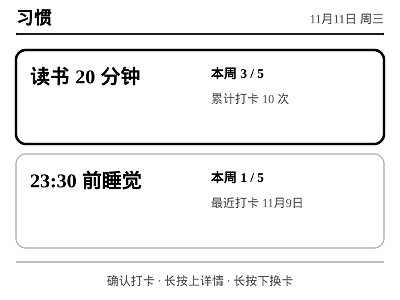
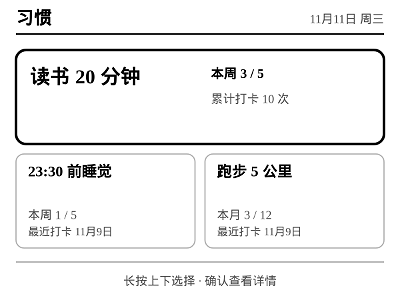
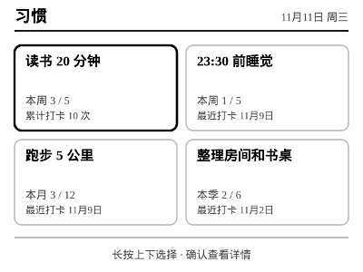
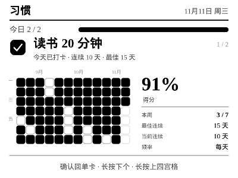
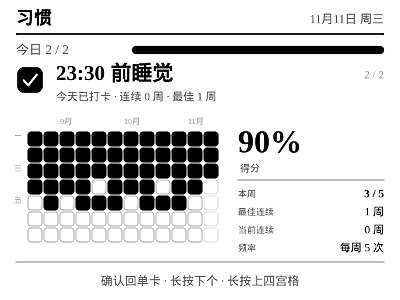

# Zectrix Habit

A habit tracker for the **Zectrix NOTE4** e-ink device, built as an app on the
[EInk-Push](https://github.com/moyubyte/EInk-Push) hub.

This repository is the challenge submission. It includes the hub framework, so it
runs without installing EInk-Push separately, and it defaults to a **habit-only**
launch mode.

## Screenshots

Screenshots are 400 × 300 renders using demo history.

| Home (single) | Home (2 pinned) |
| --- | --- |
|  |  |

| Home (3 pinned) | Home (4 pinned) |
| --- | --- |
|  |  |

| Detail (daily history) | Detail (weekly history) |
| --- | --- |
|  |  |

## What it does

- **Two home modes**
  - *Single*: one habit at a time; long down cycles through all habits.
  - *Quadrant*: pin 1–4 habits. The home screen adapts: 1 = full card,
    2 = two stacked wide cards, 3 = wide top + two small cards, 4 = 2×2 grid.
- **Fast check-in**: OK checks in / unchecks from either home mode.
- **Period-aware cards**: left side shows current-period completeness
  (`本周 3 / 5`, `本月 3 / 12`, `本季 2 / 6`). The right side shows the last
  check-in date, or total check-ins once today is already done.
- **Detail page**: 12-week heatmap, current/best streak, Loop-style score
  (90-day window, 13-day half-life, divided by frequency-expected completions),
  and the frequency panel.
- **Flexible frequency**: weekly, monthly, or quarterly, with any positive target
  count. Set from the web page.
- **Web UI** at `/apps/habit/`: add/rename/delete habits, edit frequency, choose
  quadrant pins, preview the device card, and push manually.

## Device gestures

The device has three keys. Up/down **short** is the global app switch and is not
used for habit navigation. Confirm **long** is invalid in LAN v1 and is not used.

| View | OK (short) | Long up | Long down |
| --- | --- | --- | --- |
| Single home | check in / uncheck | open detail | next habit |
| Quadrant home | check in / uncheck focused card | open detail | next pinned card |
| Detail | switch to single mode at this habit | switch to quadrant home | next habit detail |

Mode changes made on the device are persisted, so the web UI reflects the mode you
last used.

## Run it

Requirements: Node.js 22+ and npm.

```bash
npm install

# Challenge default: only the habit app is loaded.
npm start
# http://localhost:8080/ redirects to /apps/habit/

# Full EInk-Push hub: all upstream apps are loaded.
npm run start:full
```

The web interface works without hardware, including previews. To push to a real
device, open `http://<host>:8080/device` and save the Zectrix address, or start
with `--device <ip[:port]>`.

Initial web password is `helloworld`; change it on the Device page. Device
configuration is stored in `data/config.json` and is gitignored.

Tests use the mock device and do not need hardware:

```bash
npm test
```

## Standalone or hub app?

Both:

- **Standalone submission**: this repo contains the hub, so no separate EInk-Push
  checkout is needed. `npm start` loads only `apps/habit` and redirects `/` to the
  habit UI.
- **Hub app**: the same folder is a normal EInk-Push app. `npm run start:full`
  loads every upstream app alongside it, and the habit app remains available at
  `/apps/habit/`.

The habit-only mode is implemented with the hub's `--apps habit` /
`APPS_INCLUDE=habit` filter; it does not fork or duplicate the device protocol.

## Attribution

This project is based on **EInk-Push 0.4.4** by
[moyubyte](https://github.com/moyubyte/EInk-Push), licensed under Apache-2.0.
The upstream code is imported at EInk-Push 0.4.4 / upstream commit
`05211223`; the habit app, challenge launcher, screenshots, and documentation are
additions for this submission. All upstream files retain their original license
and attribution. See [`LICENSE`](../../LICENSE) and [`NOTICE`](../../NOTICE).
